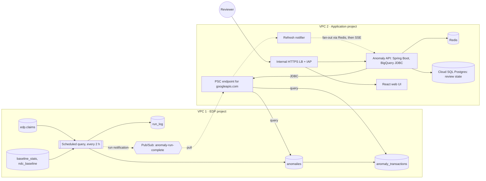

# madhava-anomaly-detection

Anomaly detection on pharmacy claims. About 10 million claims a day land in BigQuery every 2 hours. A z-score job flags unusual client windows, and a web app lets reviewers see each anomaly and every claim behind it.

The design spans two networks:

- **VPC 1, the EDP project.** BigQuery holds the claims. Detection runs here as plain SQL on a schedule.
- **VPC 2, the application project.** The web app runs on GKE and reads results through Private Service Connect (PSC).

## How it works

1. **Every 2 hours,** a BigQuery scheduled query totals each client's claim count, paid amount and reject rate for the window that just closed.
2. **It computes z-scores.** Each total is compared with the mean and standard deviation for the same weekday and 2-hour slot over the last 8 weeks: `z = (observed − mean) ÷ stddev`. Anything at |z| ≥ 3, or the client's own threshold, is written to `anomalies`.
3. **It loads the claims behind each flag** into `anomaly_transactions`. Each claim gets its own z-score, its paid amount per unit compared with that drug's norm, so reviewers can sort the most unusual first.
4. **The run reports back.** The run is written to `run_log`, and the schedule's Pub/Sub notification tells VPC 2 the run finished.
5. **The web app refreshes.** It pushes a server-sent event to open browsers, which reload. The API reads the anomaly tables over JDBC through PSC and caches results per run. Review decisions are saved in Cloud SQL.

A daily scheduled query rebuilds the baselines, so each 2-hour run reads only small stats tables.

## Repository map

| Path | What it holds |
|---|---|
| [docs/architecture.md](docs/architecture.md) | Components per VPC, the four flows as sequence diagrams, network path |
| [docs/detection-logic.md](docs/detection-logic.md) | Z-score method, baselines, guards, thresholds, late data, reruns, worked example |
| [docs/data-model.md](docs/data-model.md) | Every table: columns, keys, partitioning, retention |
| [docs/serving-and-ui.md](docs/serving-and-ui.md) | JDBC setup, query patterns, caching, UI refresh, JDBC or a Postgres copy |
| [docs/security-and-compliance.md](docs/security-and-compliance.md) | PHI handling, masking, IAM, VPC Service Controls, audit |
| [docs/operations.md](docs/operations.md) | Schedules, monitoring, alerts, runbook, backfill, cost |
| [docs/testing-and-validation.md](docs/testing-and-validation.md) | Backtesting, data checks, threshold tuning, acceptance |
| [docs/model-roadmap.md](docs/model-roadmap.md) | Next steps beyond z-score: BigQuery ML, custom library, client rules |
| [docs/decisions/](docs/decisions) | Architecture decision records |
| [docs/open-questions.md](docs/open-questions.md) | Decisions still to make |
| [docs/diagrams/](docs/diagrams) | Interactive, animated architecture pages. Open in a browser. |
| [sql/bigquery](sql/bigquery) | DDL, the two scheduled-query scripts, the UI's read queries |
| [sql/postgres](sql/postgres) | Review-state schema, plus an optional schema for the Postgres copy |
| [config/application.yml](config/application.yml) | Spring Boot config: BigQuery JDBC, Cloud SQL, Redis, refresh |
| [api/openapi.yaml](api/openapi.yaml) | API contract used by the web UI |
| [infra/terraform](infra/terraform) | Starting-point Terraform for both projects |
| [k8s](k8s) | Example GKE manifests, including the load balancer timeout for SSE |

## Getting started

1. Read [docs/open-questions.md](docs/open-questions.md) and settle the items marked *before build*.
2. Replace `edp-project` and `app-project` placeholders, and align claim column names in `sql/` with the real `edp.claims` schema.
3. Apply Terraform: `infra/terraform`, after `terraform init` and `terraform plan`. It creates the dataset, service accounts, IAM, the Pub/Sub topic and subscription, the PSC endpoint, private DNS, Cloud SQL and Redis, and both scheduled queries.
4. Run `sql/bigquery/ddl/001_edp_anomaly_tables.sql` once to create the tables.
5. Run the daily baseline job once by hand. Then backfill and backtest per [docs/testing-and-validation.md](docs/testing-and-validation.md) before turning on alerts.
6. Build the API from `api/openapi.yaml` and `config/application.yml`, apply `sql/postgres/V1__review_schema.sql` with Flyway, and deploy with the manifests in `k8s/`.

## Status

This is a design and a starting point, not a deployed system. The SQL and Terraform have not been run against a live project. Validate them with `bq query --dry_run` and `terraform plan` in a sandbox first.
