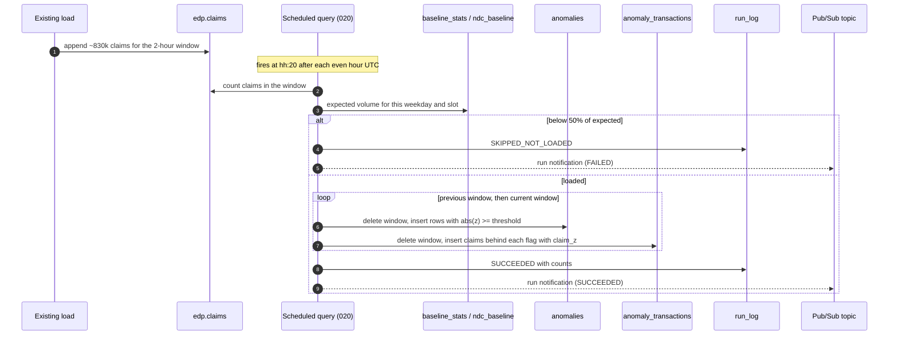
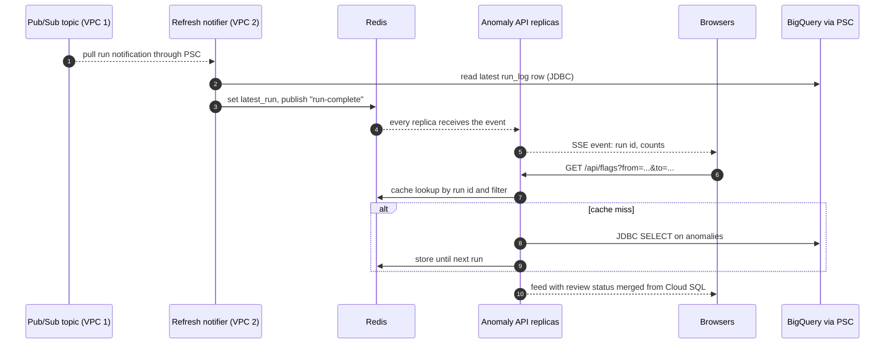
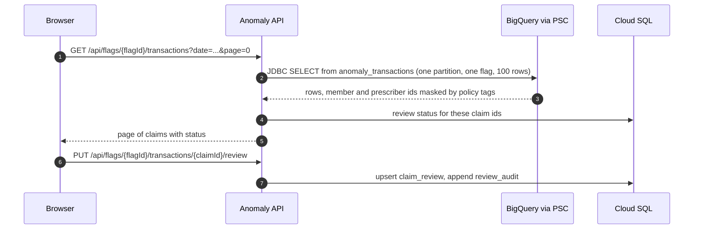
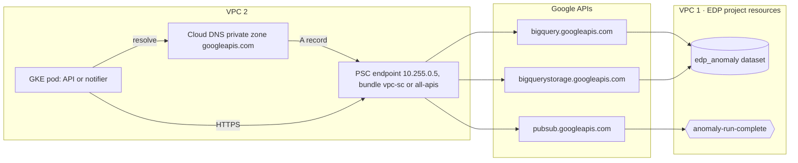

# Architecture

## Context

| Item | Value |
|---|---|
| Volume | About 10 million claims a day, roughly 830,000 per 2-hour load |
| Load cadence | Every 2 hours into `edp.claims` (existing pipeline, out of scope) |
| Detection | Z-score per client and metric for each 2-hour window |
| Users | Reviewers in a web UI who triage anomalies and the claims behind them |
| Networks | VPC 1 = EDP project (BigQuery). VPC 2 = application project (GKE web app). |
| Connectivity | Private Service Connect endpoint for Google APIs in VPC 2. No VPC peering. |

## Components

### VPC 1 · EDP project

| Component | Service | Job |
|---|---|---|
| `edp.claims` | BigQuery table | Source of truth. Partitioned by day, clustered by client. |
| Daily baselines | BigQuery scheduled query ([010](../sql/bigquery/jobs/010_daily_baselines.sql)) | Rebuilds `baseline_stats` and `ndc_baseline` from the last 8 weeks |
| Z-score job | BigQuery scheduled query ([020](../sql/bigquery/jobs/020_zscore_every_2h.sql)) | Every 2 hours: freshness check, score, load flagged claims, write `run_log` |
| `edp_anomaly` dataset | BigQuery | `anomalies`, `anomaly_transactions`, baselines, thresholds, `run_log` |
| Run-complete topic | Pub/Sub `anomaly-run-complete` | Receives the scheduled query's run notification (success or failure) |
| Governance | Dataplex policy tags, audit logs | Masks member and prescriber ids, records every read |

Nothing is deployed in VPC 1 beyond the SQL and its schedules. See [ADR 0002](decisions/0002-schedule-with-bigquery-scheduled-query.md) for when to move to Cloud Workflows or Dataform.

### VPC 2 · Application project

| Component | Service | Job |
|---|---|---|
| Load balancer | Internal Application Load Balancer, IAP, Cloud Armor | Single private entry, SSO, long backend timeout for SSE |
| Web UI | React, static files in a Cloud Storage bucket | Anomaly feed, flag detail, claim list, review actions |
| Anomaly API | Spring Boot on GKE | REST API, SSE stream, BigQuery JDBC reads, review writes |
| Refresh notifier | Spring Boot on GKE, one replica | The only Pub/Sub subscriber. Fans run events out to all API replicas through Redis pub/sub. |
| Cache | Memorystore for Redis | Results per run id, latest run, event fan-out |
| Review database | Cloud SQL for PostgreSQL | Flag and claim review status, notes, audit, saved views |
| PSC endpoint | Private Service Connect for Google APIs, Cloud DNS private zone | `*.googleapis.com` resolves to the endpoint IP |

## Flows

### 1. Detection every 2 hours (VPC 1 only)

### 2. Web UI refresh

Browsers also poll `GET /api/runs/latest` every 5 minutes, which reads one cached value, in case they missed an event.

### 3. Review flagged transactions

### 4. Daily baseline refresh (VPC 1 only)

The daily scheduled query ([010](../sql/bigquery/jobs/010_daily_baselines.sql)) reads 8 weeks of claims once and rewrites `baseline_stats` and `ndc_baseline`. Slots with no claims count as zero from each client's first day, and dates in `baseline_exclusions` are skipped.

## Network path

- BigQuery and Pub/Sub are Google APIs, not hosts inside VPC 1, so VPC 2 reaches them through its own PSC endpoint. No peering, no public IPs.
- If the EDP project is in a VPC Service Controls perimeter, use the `vpc-sc` bundle and add ingress rules for the VPC 2 service accounts. See [security-and-compliance.md](security-and-compliance.md).
- Query jobs started by the API run and bill in the app project and read the EDP dataset across projects.

## What crosses between the VPCs

| Direction | What | How often | Size |
|---|---|---|---|
| VPC 1 → VPC 2 | Run notification | 12 a day | About 1 KB, no claim data |
| VPC 2 → VPC 1 → VPC 2 | Feed queries | Cache misses, about once per run per filter | Tens to hundreds of rows |
| VPC 2 → VPC 1 → VPC 2 | Claim pages | Each reviewer page view not in cache | Up to 100 rows, masked |

No standing connection exists. Every call is a separate HTTPS request.

## Interactive diagrams

Open these in a browser. They are self-contained HTML.

- [zscore-anomaly-pipeline.html](diagrams/zscore-anomaly-pipeline.html): this design, animated, with SQL, tables, JDBC and refresh details
- [two-vpc-overview.html](diagrams/two-vpc-overview.html): the earlier two-VPC explainer of what runs where
- [claims-anomaly-platform.html](diagrams/claims-anomaly-platform.html): the broader platform: client rules, suppressions, and six model options for later phases
